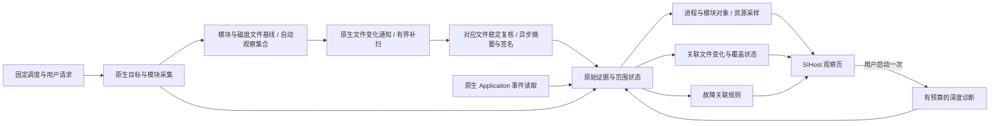

# SIHost 模块采集与故障监控设计

日期：2026-10-12。状态：功能设计基线，待实现与验收。默认观察 `sihost.exe`，重点显示第三方候选模块，复用 PCScope 的原始证据、对象、动作、采样和覆盖链路。

实施状态更新：基础运行时文件跟踪已实现并通过可控宿主及隔离后台验收，见 [首段实施验收](refactor/acceptance/SIHost-runtime-file-monitor.md)。下文保留完整目标与原型阶段记录；实现进度以该验收及 [未完成事项](remaining-work.md) 为准，整个 P0 尚未完成。

**已确认实施方向（2026-10-12）：按运行时状态发现已加载模块，再自动跟踪对应磁盘文件的状态变化。** SH15 是首版主链路；静态 PE/Manifest/注册表依赖发现、组件数据健康检查和登录前监控保留为后续扩展。当前待办及实施顺序以 [未完成事项](remaining-work.md) 为准。

首版链路：原生发现进程实例 → 成功枚举模块 → 建立带观察时间的模块/磁盘文件基线 → 自动文件观察集合 → 原生变化通知与有界补扫 → 稳定文件复核 → 同库保存、查询、展示风险。历史观察基线在进程退出后仍可用于已知文件跟踪；从未成功观察到的失败模块不会自动进入名单，不能承诺覆盖所有首次启动失败。

## 1. 产品目标与边界

用户应能回答：当前哪个 SIHost 实例正在运行、加载了哪些模块、哪些值得优先查看、最近出现了什么变化、是否有崩溃/资源异常，以及第三方功能未生效时还缺哪些证据。

模块存在、签名可信、宿主存活和功能生效分别表示。第三方身份本身不是故障；微软签名不是系统自带组件或运行正确的充分证明。默认只读原生采集，不启动 PowerShell，不向 SIHost 注入代码或主动加载待检查 DLL。

默认只观察当前用户交互会话。用户可停用 SIHost 预设；“默认启用”不写成不能取消的硬编码。其他账户/会话须显式选择并检查权限。`explorer.exe`、`ShellExperienceHost.exe`、`StartMenuExperienceHost.exe` 可作为后续关联目标，不能把它们的模块算作 SIHost 模块。

该能力优先支持 Windows 10 LTSC x64 和 Windows 11 x64，分别验收；ARM64/跨位数、受保护进程等未验证范围保持明确状态。常规模块 API 不保证看到手工映射、仅作为数据文件映射、已在两轮之间卸载的模块或被修改的内存代码。[Microsoft 模块枚举](https://learn.microsoft.com/en-us/windows/win32/api/psapi/nf-psapi-enumprocessmodulesex)

## 2. 功能清单与优先级

| 编号 | 功能 | 采集和处理方式 | 用户看到的结果 | 阶段 |
| --- | --- | --- | --- | --- |
| SH01 | 目标进程发现 | 精确名称预设；校验实际路径、PID、建立时间、会话及可读取的账户身份 | 进程实例、权限范围、最近观察时间；未观察到与发现失败分开 | P0 |
| SH02 | 加载模块清单 | x64 原生 PSAPI，按进程独立范围读取；不执行 DLL | 路径、加载基址、映像大小、版本、公司和产品声明、首次/最近观察 | P0 |
| SH03 | 签名与第三方候选 | WinVerifyTrust，包含嵌入签名和本地 Catalog；保存签名发布者、证书和返回码 | 微软签名、其他发布者、未发现签名、验证失败/未知；第三方候选优先 | P0 |
| SH04 | 宿主资源采样 | 原生累计 CPU 时间、工作集、私有提交、线程/句柄等可读指标 | CPU/内存趋势和持续异常线索，不把进程 CPU 直接归给某个 DLL | P0 |
| SH05 | 快照变化 | 同一进程实例下比较成功清单，记录前后观察区间 | 新观察到、后续未观察到、文件版本/签名变化；不冒称精确加载/卸载时间 | P0 |
| SH06 | 崩溃与无响应关联 | 复用 Application 原生事件，按提供程序、事件字段、进程身份、报告 ID 关联 | 宿主崩溃/无响应报告、异常码、日志报告的故障模块及证据强度 | P0 |
| SH07 | 覆盖与历史 | 独立记录发现、模块、签名、资源和事件读取结果 | 权限不足、部分读取、过期结果、采集间隔/日志缺口；不显示虚假的全历史完整 | P0 |
| SH15 | 已加载模块文件跟踪（主链路） | 从成功模块清单派生自动名单；原生目录通知、可用 USN、有界补扫和异步稳定校验 | 模块关联文件的删除、移动、替换、内容/版本/签名/权限变化及覆盖缺口；详见第 16 节 | P0 |
| SH08 | 加载/卸载时间线 | 原生 ETW Process/Image 事件与初始清单同步；记录丢事件及捕获区间 | 捕获范围内实际加载/卸载、重启、短暂模块；区间外仍未知 | P1 |
| SH09 | 第三方功能证据 | 明确支持的组件只读适配器，读取用户指定的日志/状态接口 | 注入、初始化、符号或 Hook 失败等原始报告；没有适配器时功能状态未知 | P1 |
| SH10 | 按需诊断 | 单次有预算的 ETW/资源调用栈或转储；先展示范围与成本再由用户启动 | 可导出的诊断材料、时间范围、分析依据、停止原因 | P1 |
| SH11 | 可复现归因 | 分析栈、组件日志、版本变更及用户控制的对照结果 | “相关线索/支持关联/人工确认”，不自动停用、卸载或指责模块 | P2 |

首版 P0 包含 SH01–SH07、SH15。先打通 SH01/SH02/SH03/SH05/SH07/SH15 的文件跟踪闭环，再补齐同阶段的 SH04 资源和 SH06 故障关联；文件跟踪完成与整个 P0 完成分别验收。SH08–SH14 为后续能力，不作为文件跟踪闭环的前置条件。

## 3. 采集架构

入库、事件到达和页面刷新不触发新的采集循环。关联规则也不启动诊断、重新验签或补扫。没有原生程序或权限不足时返回具体范围的错误，不回退 PowerShell。

### 3.1 建议默认值

以下是设计值与验收目标，不是本机已测出的性能保证。

| 项目 | 默认值与上限 |
| --- | --- |
| 发现及资源采样 | 每 10 秒；CPU 根据两次累计时间差计算，首个样本和 PID 世代变化时不计算 CPU 百分比 |
| 模块枚举 | 启用时、新进程实例出现时读取；之后每 60 秒；单次异常补扫也受 30 秒冷却约束 |
| 签名检查 | 新文件/指纹变化时检查；缓存到期再复核；离线缓存策略默认有效期 24 小时，界面显示实际验证时间 |
| 签名工作量 | 每次至多 32 个新文件或 2 秒处理预算；剩余显示待验证，后续固定调度继续；已采模块清单先保存 |
| 并发 | 一个模块任务、一个签名任务；同一进程不重叠枚举；复用现有独立日志通道，不增加第二套全量日志轮询 |
| 范围 | 至多 32 个精确名称、32 个进程实例、每进程 4096 个模块；拒绝通配符/任意 shell 参数 |
| 单文件检查 | 64 MiB 默认上限；超过上限标记未验证，仍保留模块身份和大小 |
| 失败退避 | 按目标及能力分别 60、120、240、480、900 秒；一个实例失败不降低其他实例的读取频率 |
| 深度诊断 | 默认手动开启 60 秒；一次只允许一个会话；ETW 预算 64 MiB；默认不采进程内存转储 |

签名的 2 秒是调度批次预算，不是 Windows 单个 API 一定能在 2 秒内返回的保证。验签放在固定原生工作进程，按文件至多 5 秒、单批至多 15 秒监督；超时终止该 Job，保留已完成结果，当前文件标未知，剩余队列仍待验证。队列按文件指纹去重并有 4096 项上限；超限明确报告待验证覆盖不足，不能静默删除已得到的结果。

实际进程实例超过上限时，已读取的实例可独立保存，但目标发现状态必须是部分，不准声明覆盖全部实例。模块清单超过上限或枚举过程中不稳定时，不提交该进程的完整空/截断快照；其他进程正常提交。失败重试、签名队列和诊断会话均持久记录恢复状态，后台重启不反复启动诊断。

### 3.2 签名和文件身份

先保留模块清单，再异步验签，避免一个签名 API 超时使整个 SIHost 清单不可见。检查使用无 UI、只读、仅本地缓存的 WinVerifyTrust；Catalog 也需要覆盖。缓存键必须含文件身份、大小、写入时间、内容指纹（已取得时）及验证策略版本；相同路径不等于相同文件。无法建立稳定指纹时不沿用旧的“已验证”结果。缓存记录 checked_at 和复用依据，不把复用时间写成新验签时间。

签名验证的是当时磁盘文件，不证明加载到进程内存的字节未变化；文件替换或检查期间变化时标未知。离线通过不代表撤销信息最新；在线复核作为用户选择的独立操作，不自动联网。[WinVerifyTrust 检查选项](https://learn.microsoft.com/en-us/windows/win32/api/wintrust/ns-wintrust-wintrust_data)

“微软签名”和“微软系统自带”不合并：证书发布者可能是微软，而产品/驱动来自合作厂商；公司/产品字段是文件自述。完整保存发布者、证书主题/指纹、签名类型、验证码、时间、文件指纹、公司声明和归属依据。只有额外包归属证据支持时才显示确定的产品归属；其余标“候选/未知”。

## 4. 数据模型与来源去向

| 数据 | 身份/关键字段 | 去向 |
| --- | --- | --- |
| 目标配置 | 精确名称、账户/会话范围、开关、各能力周期、阈值、修订号 | 配置和原始范围证据 |
| 进程实例 | 安装身份 + PID + 原生建立时间；路径、Session ID、账户读取状态、退出观测 | 复用 runtime.process；不能仅凭名称/PID 归一 |
| 模块快照 | 进程实例 + 规范路径；基址、映像大小、版本、文件声明、观察时间 | 复用 runtime.module_instance，扩展字段和详情 |
| 精确加载实例 | 进程实例 + 基址 + 已观测加载世代；捕获会话、事件时间、路径 | P1 动作/加载区间；来源不足时不伪造世代或精确加载时间 |
| 文件签名 | 稳定文件身份/指纹 + 策略版本；磁盘路径、检查时间、原始结果 | 原始证据与模块字段关联；不改变已加载实例身份 |
| 模块/文件关系及自动名单 | 进程实例、模块路径/基址、观察时磁盘卷/文件身份、基线证据、修订号、活动/历史范围 | 同库持久关系；独立于手动名单，监听按文件/父目录去重 |
| 文件变化与复核 | 新旧路径/身份/指纹/版本/签名/ACL、通知或补扫来源、稳定性与读取状态 | 复用文件对象与原始证据，查询关联模块及有效监控区间；不推断内存变化 |
| 资源样本 | 进程实例 + 采样时间；累计量、计算区间、CPU/内存/句柄等 | 采样路径，不生成重复对象动作 |
| 故障记录 | 日志通道世代 + Record ID/正文指纹；报告 ID、进程时间、故障模块、异常码 | 保留原始事件，产生来源报告的动作与关联解释 |
| 覆盖/诊断会话 | 目标、能力、尝试时间、有效观察区间、丢失量、停止原因、预算 | 覆盖与诊断材料管理 |

保留现有 `pcscope.execution.modules` 来源；其原生归属必须在构建、生成清单、适配和生产包装器实测通过后认定完成。模块对象当前适配器只显式映射进程、路径、大小、版本，发布者和签名等字段仍需扩展到 catalog、投影、查询与 UI，不能只把数据写进原始 JSON。

建议新增来源（设计名，尚未注册）：`pcscope.execution.shell-targets` → 目标进程观察；`pcscope.execution.shell-resources` → 进程资源样本；`pcscope.execution.module-scan-status` → 范围/检查摘要；P1 的 `pcscope.execution.image-events` → ETW 动作证据。注册时必须同时更新来源清单、控制、原始保存、适配去向、查询、界面和验收，不改清单掩盖未完成工作。

模块列表不变时保存本轮扫描摘要和前次完整快照引用，说明本轮重新枚举成功；模块字段或签名结果变化时保存完整快照/独立验签证据。摘要需要清单指纹、数量、范围和参考证据 ID；不是静默丢弃已经取得的字段。原始快照受现有配额管理，摘要依赖必须一同处理；重启、引用失效或保留裁剪后重新取得完整基线。该优化必须通过契约与回读验证后启用，不能直接拿现有“什么都不写”替代。

时间全部保存为 UTC，界面按本地时区显示。首次观察不当作加载时间；未在后续快照看到不直接当作卸载；发现失败不制造退出动作。若有原生句柄退出通知或匹配生命周期事件，可以记录对应来源与时间精度。

## 5. 状态与判定规则

五个独立维度：目标/模块采集状态、签名状态、宿主状态、功能状态、原因确认程度。每一维均保留来源和最近证据时间，其他维成功不抹掉这一维的缺口。

| 情况 | 显示与判断 | 禁止的推断 |
| --- | --- | --- |
| 模块已枚举成功 | 本次已加载/已观察到；显示观察时刻 | 不显示功能正常 |
| 验签通过且发布者非微软 | 其他发布者签名；列入第三方候选 | 不显示恶意、故障或已生效 |
| 没有签名/信任检查失败 | 分别显示未发现签名、验证失败、未知及原始码 | 不把信任失败统一写成无签名 |
| 无 SIHost 匹配实例 | 发现确实成功时显示“未观察到目标”；发现失败时显示缺口 | 不判定 DLL 全部卸载、系统崩溃或用户必须有 SIHost |
| 组件日志报告初始化失败 | 显示组件报告的功能未生效及具体原因 | 没有组件证据时功能状态保持未知 |
| Application Error/1000 匹配实例 | 宿主崩溃已报告，保留故障模块与异常码 | 不直接把故障模块当根因 |
| WER/1001 | 解析报告类别/报告 ID；作为报告或补充关联证据 | 不把所有 1001 都认定为崩溃 |
| Application Hang/1002 匹配 | 宿主无响应已报告；保留相关字段 | 没有该事件不代表没有卡死 |
| 持续高 CPU 或内存增长 | 显示资源异常线索及阈值、计算区间 | 不直接确认死循环/内存泄漏或归给某个 DLL |
| 进程存活但无 GUI 窗口 | 功能/响应状态未知，支持按需栈分析 | 不把窗口响应检查不能执行写成健康 |

崩溃关联优先顺序：相同报告 ID → 相同 PID + 建立时间 + 路径 → 路径与时间范围的候选。字段不足、多实例或多个报告匹配时保留歧义，时间接近只能做线索。区分日志 System 的写入 PID 与 EventData 的故障 PID。晚到日志按来源事件时间关联，不能按入库时间绑定当前进程。[Microsoft 崩溃诊断与故障模块边界](https://learn.microsoft.com/en-us/troubleshoot/windows-server/performance/troubleshoot-application-service-crashing-behavior)

ProcMon 的文件搜索失败只是加载调查线索；找到某次 NAME NOT FOUND 不自动确认最终 DLL 加载失败。精确失败需要组件/加载器返回码或等价证据。[LoadLibraryEx 依赖与失败约定](https://learn.microsoft.com/en-us/windows/win32/api/libloaderapi/nf-libloaderapi-loadlibraryexw)

## 6. 异常提示与恢复

初始建议规则：单进程 CPU >= 一核 80% 持续 60 秒；5 分钟内 3 次匹配的崩溃/重启报告；资源增长趋势先显示曲线，默认不自动宣称泄漏。CPU 同时显示“一核占用”和“占整机比例”，不混用核数；阈值可调且必须经本机标定。高 CPU 不是 SIHost 特有故障诊断。

每个目标/规则只维护一个活动事件；重复样本追加证据，5 分钟合并相同提示。采样缺口、会话退出、后台重启时不跨缺口计算持续时间。资源规则连续 3 个有效正常样本后结束本次异常；崩溃报告为历史事实，不因后续正常样本消失。宿主恢复不自动认定第三方功能恢复。

第三方候选模块新出现、版本改变、验签未知默认为信息提示，不弹出红色故障警报。提示仅在应用内，默认不向外部服务发送数据，不自动请求 UAC、重启 SIHost、停用模块或开启转储。

## 7. 界面与配置

提供“SIHost 观察”入口：顶部显示当前进程实例/会话、最近成功扫描、采集覆盖、资源趋势和活动异常。模块表按“其他发布者、签名未知、微软签名”分组/筛选，保留“全部”入口及各组总数，不隐藏微软模块。

模块列：文件名、完整路径、签名发布者、产品/公司声明、签名状态、版本、大小、首次/最近观察、关联故障数。可展开查看原始数据、证书、签名时间、文件指纹、采集限制和时间线。功能状态、宿主状态单独展示，不用一个绿色“正常”覆盖所有维度。字符串按不可信输入转义，签名/文件路径字段支持搜索，分页标明完整数量。

异常详情按时间排列：前次模块基线 → 模块/版本变化 → 资源线索 → 来源报告的崩溃/挂起 → 后续进程观察。明确每一步是事实、候选关联还是确认结论，并可跳到原始事件。支持导出当前清单、变化与故障证据；转储属于单独明确选择的导出项。

配置由后台持久化，增加受类型约束的目标设置/查询/诊断 IPC；只允许固定监控能力与受验证参数，不允许任意命令字符串。目标范围、开关或阈值修订后，排队/运行中的结果带修订号校验，不能把旧范围结果覆盖新设置。每次用户点击只启动一次请求，不持久开启深度诊断。

## 8. 按需诊断与权限

基础进程/模块观察先使用当前账户的必要只读权限；被拒绝返回该实例的 Win32 码、所需能力、历史有效观察，不循环请求管理员。需要提升时复用产品同账户增强后台，仍不能保证访问受保护进程。ETW 使用受控会话、独立缓冲区和能力检查，明确记录丢事件及停止/重启缺口；已有 Sysmon ImageLoad 可作为额外来源，不自动安装 Sysmon 或修改其策略。

ETW 支持 Load/Unload 和区间初末清单，但不保证捕获所有加载失败，不恢复捕获前历史。只有在捕获连续且没有丢事件的区间内才能声明对应事件覆盖。[Microsoft Image_Load](https://learn.microsoft.com/en-us/windows/win32/etw/image-load)

诊断允许用户选择：加载/文件访问调查、CPU/等待栈分析、进程转储。全转储需另列估算大小、容量上限、目标实例与当前账户权限；超出预算则停止并保留原因，不截断后伪称完整。默认不全局注册 WER LocalDumps，不自动修改审计/日志/系统服务。转储可能包含进程内存中的用户数据，使用工作区/产品隔离目录、访问控制和显式导出，不自动上传。

ProcDump 的 -h 依赖窗口无响应，不能用它替代 SIHost 全部内部线程健康判断；栈分析/转储也不保证唯一根因。转储/ETW 的时长和容量预算与正式数据库配额共同检查，诊断结束释放会话和句柄。[ProcDump 的触发方式](https://learn.microsoft.com/en-us/sysinternals/downloads/procdump)

## 9. 性能与防循环验收目标

常驻采集不订阅 Windows 事件后立即递归触发自身；只由时钟/去重后的用户请求启动。资源样本、模块快照、签名工作队列分别限流。签名失败不频繁重读同一个 DLL；诊断触发不驱动下一次诊断。

首轮目标（待测）：当前用户单 SIHost、<=300 模块，温缓存模块枚举 p95 <=500 ms；资源采样 p95 <=50 ms；无诊断时新增监控平均占整机 CPU <=0.5%，增量私有内存 <=64 MiB。冷缓存验签独立报告耗时/文件 I/O，不能拿热缓存成绩替代冷启动。未变化清单的保留增长须比每分钟完整快照减少至少 90%，同时证明摘要引用与历史回读一致。

至少跑 24 小时稳定与重复手动请求观察：无并发重复任务、无采集事件反馈链、权限失败按预算退避、数据库/诊断产物不被自身文件监控反复采集。记录目标模块数、CPU 核数、磁盘、缓存冷热、运行身份、实际配置和每种诊断模式，结果只适用于所测环境。

## 10. 分阶段实现与验收

| 阶段 | 必须完成 | 完成门槛 |
| --- | --- | --- |
| P0 文件跟踪与基础观察 | SH01–SH07、SH15；先完成运行时模块→文件跟踪闭环，再补资源与故障关联；目标配置、独立范围、自动名单、异步队列、完整 UI/查询/导出 | 文件跟踪闭环与整个 P0 分别记录结果；Win10/Win11 实机与可控夹具通过；真实包装器到隔离库/UI闭环；功能未知不伪报正常 |
| P1 连续/诊断与依赖扩展 | SH08–SH10、SH12–SH14；ETW、明确组件适配、一次性诊断、额外已知依赖预检及启动阶段覆盖 | 各能力独立验收；明确静态候选与实际加载、实际覆盖的启动区间；事件丢失/容量上限有证据；不修改正式设置 |
| P2 归因增强 | SH11；调用栈关联、版本/更新对照、用户控制的复现材料 | 故障位置与根因分开；明确支持的组件可解释功能状态，未支持组件仍未知 |

关键验收案例：正常微软模块；有效第三方签名；Catalog-only 模块；签名验证失败/过期/离线未知；同路径替换文件；已加载但功能未生效；无目标进程与枚举权限失败；多会话同名进程和 PID 复用；单实例失败而其他实例成功；枚举时退出/加载变化；模块短暂加载卸载；宿主崩溃事件与故障模块误归因；WER 非崩溃报告；日志晚到/乱序/旧 PID；高 CPU 的归一化与恢复；没有窗口的进程；开关修订时正在采集；退避重启恢复；ETW丢事件/超时/超额；诊断结束清理；分页/导出/原始回读一致。

使用独立可控测试进程制造崩溃、卡死、卸载/替换和第三方 DLL，不把故障 DLL 注入真实 SIHost，也不杀真实 Shell 来测试规则。第三方签名链与 Catalog 对照需要真实合法样本和可复现实机结果，不能只靠假造证书字段的单元测试证明正确。

## 11. 当前代码差距

`plugins/platform-native/Modules.cs` 已有一个未完成验收的原型，涉及原生枚举、磁盘签名和默认 SIHost 选择。前次隔离探测只有 16 个空分片，未取得正向 SIHost 模块证据；不能据此宣称权限/签名/第三方识别已通过。当前来源生成清单及 `dist/native-safety` 仍对应此前验收基线，本设计不把原型改动计入已验收来源数量。

实现前需修正/补齐：默认预设可停用、用户/会话范围、按实例独立提交、发现状态、模块清单与签名分离、签名发布者与产品归属区分、持久缓存/退避、自动文件名单与原生监听、历史基线恢复、资源与故障关联、适配字段和 UI。先完成对应来源的端到端验收，再将模块来源正式计为原生；不覆盖此前包或历史验收。

其他参考：第三方组件可能因注入、版本或调试符号问题不生效，必须查看其自身报告；[Windhawk 作者排障资料](https://github.com/ramensoftware/windhawk/wiki/Troubleshooting) 是一个明确组件的例子，不是通用第三方健康 API。最新 Sysinternals 工具的系统支持范围须单独检查，不能替代 Win10 原生后端兼容验收。

## 12. 接入当前软件架构

结论：可以作为现有 PCScope 的通用进程监控能力接入，SIHost 是首个默认目标预设。沿用同一个后台、history.db、原始证据与对象模型、统一查询入口及桌面应用。当前已有合适的基础，但以下扩展尚未实施，不能把“架构可接入”当成“已经接通”。

### 12.1 按现有层接入

| 架构层 | 可复用基础 | 需要扩展的接入点 |
| --- | --- | --- |
| 原生采集 | `plugins/platform-native/Program.cs`、`Sources.cs`、未验收的 `Modules.cs` 原型；标准快照/gap 协议 | 固定进程发现、资源、模块、验签工作模式；按实例分范围；清单先提交、验签异步；默认目标可停用 |
| 进程监督 | `crates/supervisor/src/lib.rs` 的 Job、超时、字节预算与真实进程身份 | 模块/资源单次调用继续复用；独立验签任务固定预算；P1 连续 ETW 需要新增受监督订阅/背压模式，不能塞进现有一次性 collect 等待返回 |
| 服务与调度 | `crates/service/src/main.rs`、`schedule.rs` 的去重、冷却与固定时钟；日志独立读取 | 将任务类型/执行通道显式化，增加有界 runtime 通道；进程资源 10 秒、模块 60 秒、验签队列分别控制；来源配置与调度任务分开映射 |
| 保存与投影 | `crates/storage/src/evidence.rs`、`projection.rs`、服务 `projection.rs` 的统一原始保存及可恢复队列 | 新来源全部经过 ingest/project_pending；模块字段、样本、扫描摘要、故障关联各有声明去向；不绕过队列直接写 UI 状态 |
| 对象与语义 | `runtime.process`、`runtime.module_instance`、`adapters/runtime.rs` 和现有 Application/WER 事件解释 | 加入签名/发布者/观察时间字段、标准进程引用及有证据的故障动作；未知字段保留；故障位置与根因分开 |
| 查询与 IPC | `Request::Query`、`QueryRequest::InstanceList/InstanceDetail/ActionTimeline/SourceReadings/SourceCoverage` | 增量加入精确进程引用、签名类别过滤和资源时间区间/聚合参数；增加类型受限的监控配置/诊断控制请求 |
| 桌面 | `app.js`、`model-view.js`、`object-details.js`、`settings.js`、`monitoring.js` | 增加通用进程观察组件，SIHost 预设入口；复用对象详情、时间线、覆盖、设置与导出；不在前端重新判定根因 |
| 来源与发布 | `model`、`check-source-inventory.cjs`、来源控制、`stage-dev.ps1` | 允许有声明且有实际发射点的 native-only 新来源；同步 catalog/control/query/UI/测试；更新原生构建清单和新隔离开发包 |

上述路径均以项目根目录为基准。无需另开一个监控软件、另建独立业务数据库或更换前端框架。

### 12.2 必须解决的具体架构约束

1. **调度频率和任务隔离。** 当前 `Job` 只用 events 布尔区分状态/日志，两条执行通道；状态周期下限 30 秒、默认 300 秒。资源采样不能通过降低全部状态任务周期实现，也不能借日志通道冒充资源任务。P0 增加 runtime 类型/通道及固定执行器；一个目标资源任务与模块任务按到期时间运行，签名单独有界队列。不启动第二个后台，不让资源读取等待整个 system/scoped 领域采集结束。
2. **一个来源只能有一个正式采集归属。** `pcscope.execution.modules` 的模块执行任务可直达原生程序，但沿用已有 scoped 来源控制。调度任务 ID 与 collection selection 的归属单元显式映射，不能拿新 job 名直接查询现有控制表；普通 scoped 调度必须排除已交由 runtime 任务执行的模块来源。否则会双重采集，或因找不到控制项而误跳过任务。关闭来源时取消在途/排队工作，修订号验证后才能提交。
3. **新原生来源登记。** 当前 inventory 逻辑假设原生接管已有 PS 发射来源。目标资源/扫描摘要是 native-only 新来源，应扩展真实发射扫描与单位/catalog/control校验，不添加空 PS 采集器来绕过检查。原生来源失败仍不回退 PS。
4. **采样查询需要真实扩展。** 当前 `reading_destination` 与 storage `source_readings` 只接受资源/配置等四类已声明来源，不能只增加一个 JSON source 就宣称目标资源可查询。注册新非对象来源、增加样本身份/时间参数和索引，校验分页、水位与筛选指纹；范围筛选必须在分页前执行，不能由前端下载全部数据再筛。
5. **进程关联需要标准身份。** 现有模块适配器的 process_identity 是 PID/启动时间字符串，process 字段只是 PID，还没有正式进程对象引用。新增引用通过现有身份/引用机制生成，不自行拼 SQL 对象 ID；统一建立时间精度和安装范围。新增精确过滤使用标准进程引用，不以全文搜索 `sihost` 代替，防止同名、多会话和 PID 复用串联。
6. **签名不是一次快照的前置条件。** 模块对象独立存在，验签结果作为指向该模块文件指纹的证据/字段更新。验签延迟或失败只影响签名维度；模块列表仍可见。签名缓存、工作状态和重复异常合并使用同库持久状态，不仅保存在前端或后台内存中。
7. **业务解释在后台。** 崩溃、资源阈值及关联强度由可版本化的适配/规则与持久证据计算；页面只显示结果与依据。用户刷页不重新生成故障，不调用采集程序。晚到事件、故障证据裁剪或规则更新保持可重算与幂等。
8. **数据结构遵循新库计划。** 目标设置可复用 settings；缓存/诊断状态/索引需要结构时统一修改新程序初始化与 schema 定义。设计阶段不预占 schema 号，不打开或自动迁移旧正式库。历史包、旧验收和新模块原型分别标注。

### 12.3 接入顺序与门槛

先完成隔离数据目录与 IPC，在普通权限可控夹具上取得正向目标/模块证据；分离模块清单与签名，持久保存模块/文件关系和自动名单；再接原生文件监听、稳定复核队列与 runtime 调度，同时扩展 catalog、适配及统一查询；最后完成 SIHost 预设页面、原始导出、资源与故障关联。只有“实际原生采集 → 文件跟踪 → 原始保存 → 投影/采样 → 统一查询 → 页面/导出”全部通过，才发布 P0。具体依赖与验收见 [未完成事项](remaining-work.md)。

P0 复用 Application 读取，不要求 ETW 常驻或 Windows 系统服务已安装。P1 再扩展 ETW 订阅与诊断会话，保留相同原始证据和查询通路。以后支持其他进程时增加目标预设/组件适配，不复制一套 SIHost 专用数据库、调度器和事件解析器。

新增集成验收：同时运行普通领域采集与 runtime 任务仍不重复模块来源；关闭模块控制后无绕路采集；10 秒采样不改变日志/其他状态周期；两个会话同名目标不会混页；资源/签名/故障查询具备相同水位与分页语义；重启后队列和规则状态可恢复；查询期间采集与投影继续运行；页面刷新不新增原始快照或触发诊断。

## 13. 加载前损坏与启动风险预检

补充场景：第三方模块自身或依赖数据已损坏，导致 SIHost 无法启动，或者启动后立即退出。当前已实现模块路径是“发现运行进程 → 枚举已加载模块 → 检查磁盘签名”；失败模块可能不在清单中，进程可能根本不存在。文件观察支持显式名单和可选哈希，但默认关闭哈希，也没有模块依赖基线/启动风险规则。当前产品不能宣称具备该场景的自动提前预警。

### 13.1 新增能力

| 编号 | 能力与来源范围 | 判定与接入 | 阶段 |
| --- | --- | --- | --- |
| SH12 | 扩展已知依赖风险预检 | 在 SH15 已观察文件基线之外，增加静态依赖、组件声明或用户指定依赖；检查存在性、稳定身份、指纹、签名和 PE 基本结构，并保存依据 | P1 可选扩展；限定后台已运行及已登记范围 |
| SH13 | 启动阶段覆盖与失败关联 | 不依赖桌面的后台在其实际可覆盖时间内记录目标进程起止、加载及加载器/组件错误；记录未覆盖的启动区间；提供 CLI/独立证据导出 | P1；登录前覆盖需要另行实现机器侧后台 |
| SH14 | 模块依赖数据的格式/健康检查 | 用户明确指定的组件配置/数据库由版本化适配器只读检查；保存范围、错误和原始依据；通用文件检查不擅自解析所有第三方数据 | P1，逐组件支持 |

按最新确认方向，历史成功观察的模块文件及其后续跟踪属于 P0 的 SH15；SH12 增加其他依赖来源，不再扩大首版必做范围。SH13 未实现前，两者都不声明覆盖尚未启动后台时的登录/启动过程。

### 13.2 依赖基线和预警证据

基线来源分开记录：历史成功加载、目标 PE 静态依赖、组件声明/安装清单、用户指定文件。历史成功加载只能证明曾观察到，不证明下次启动必需。启动必需、可选、按条件加载和角色未知分别表示；不把之前所有模块都列为 SIHost 启动必需。

每个条目保存目标预设、实际文件路径/身份、包或组件版本、基线内容指纹、签名策略和结果、依赖角色与依据、有效时间、最后检查时间和读取范围。首次基线已损坏或来源未验证时标未知，不能把“首次看到”当作可信健康基线。合法更新产生新候选基线，不自动覆盖此前有效基线并抹掉变化，也不把一切版本/哈希变化都叫损坏。

预检状态：文件缺失、不可读取、内容指纹变化、内容完整性验证失败、PE 结构/架构异常、数据格式验证失败、待检查、无法判断。保留原始错误码及检查器版本。“签名失败”进一步区分摘要不匹配、证书/信任问题和检查能力缺失；读不到文件可能只是监控账户无权限，不代表 SIHost 自身读不到。

静态依赖解析须处理正常的 API Set/SxS/条件依赖语义。无法可靠解析实际加载路径时标未知，不把虚拟依赖名称当成磁盘必须存在的 DLL。预检不调用 LoadLibrary 执行第三方 DLL 的初始化，也不尝试向 SIHost 注入来“验证能加载”。依赖不存在或初始化入口失败确实可以使加载失败，但静态完整性正常不能保证初始化和实际启动成功。[LoadLibraryEx](https://learn.microsoft.com/en-us/windows/win32/api/libloaderapi/nf-libloaderapi-loadlibraryexw)、[DllMain 初始化约定](https://learn.microsoft.com/en-us/windows/win32/dlls/dllmain)

### 13.3 不依赖目标存活的触发方式

后台启动时检查已登记基线；目标当前不存在时仍检查其已登记文件。原生文件变化通知用于将指定条目标记待检查，短时间合并同一文件的更新/写入；再按有界队列校验稳定文件，并以固定低频扫描补足通知溢出/漏掉的区间。通知溢出、后台停止和重启都记录覆盖缺口，不假定零丢失。沿用验签/文件大小、并发与超时预算，不因每个写入立即全量重算所有依赖。

示例展示：“某第三方关联文件的内容完整性检查失败；SIHost 当前仍在运行；下次使用该文件可能受影响；是否为启动必需依赖尚未确认。”文件异常、使用关系和启动因果是三项独立证据，不合并成已经确认 SIHost 将无法启动。

若损坏发生在后台启动之前、刚检查之后或本次目标实际加载之前的极短间隔，只能在首次取得相应证据时报告，不保证总能抢在启动失败前通知。常规用户后台在桌面之后启动，无法自动提供此前的登录前监控；安装机器服务也必须实测启动顺序和实际 ready 时间，不凭“开机自启”宣称一定先于 SIHost。机器侧采集继续遵守固定只读能力与用户数据范围，不能借系统账户直接读取另一用户 DPAPI 历史。

### 13.4 能提前提示与不能提前确认

| 场景 | 有基线且后台已运行时可取得的证据 | 能否据此提前确认启动失败 |
| --- | --- | --- |
| 指定 DLL 被删除/文件结构损坏 | 文件缺失、结构异常、完整性差异 | 可提示风险；仍须确认实际加载路径与必需依赖关系 |
| DLL 合法升级 | 版本/指纹/签名变化 | 不能把变化当损坏或失败 |
| DLL 文件正常、配置/数据库损坏 | 通用检查只有文件元数据；有组件适配时可报告格式/健康错误 | 无组件证据时未知 |
| 初始化代码 bug、Hook 与系统版本不兼容 | 静态文件可能全部正常 | 通常需实际运行、组件日志或故障材料 |
| SIHost 启动后瞬间退出 | 周期枚举可能漏掉；连续生命周期/原生错误事件可补充 | 属于启动过程/事后证据，不冒充提前预警 |
| 本机没有任何有效基线且目标首次启动就失败 | 能做有限文件/结构/签名检查；未知依赖无法覆盖 | 不承诺识别全部第三方依赖或唯一原因 |

新增验收使用可控宿主与 DLL/数据夹具：健康基线后损坏磁盘文件但宿主仍运行；进程不存在时仍发现基线文件异常；合法更新不误报损坏；被拒绝的监控读取不误报目标拒绝访问；可选模块缺失不报必需依赖失败；数据格式错误与 DLL 签名正常同时存在；首次无基线；通知溢出和更新写入中；检查后立即变化；后台晚于宿主启动时显示缺口；快速启动退出与 PID 复用。文件异常到启动失败的关联必须保留独立证据和不确定性，不通过破坏真实 SIHost 测试。

## 14. 非运行时的依赖与加载配置发现

没有找到微软公开定义的一份 SIHost 全量模块配置文件。需分别采集“二进制声明的依赖”“系统/组件配置的候选”“历史实际加载”，并保留证据类别和生效条件，不能把它们合并成一个没有来源说明的必需 DLL 清单。

| 输入 | 读取范围与能回答的问题 | 不能直接推断 |
| --- | --- | --- |
| SIHost EXE 的 PE 普通/延迟导入表 | 从磁盘解析 DLL 名称、架构和引用，不启动 EXE；对已经确认的关联 DLL 有界解析传递依赖 | 不包含全部 LoadLibrary、COM、运行时注入；延迟导入不等于启动时必需；API Set 名称不是必须同名存在的物理文件 |
| 应用/组件 Manifest | 读取内嵌 RT_MANIFEST、适用的旁置清单及声明的 SxS 依赖；不存在也记录扫描结果 | 不假定 sihost.exe 必有外部 manifest；清单不保证包含所有模块 |
| COM 配置 | 对已有组件/历史证据关联的 CLSID，读取 HKLM/HKCU Software\\Classes\\CLSID\\{CLSID}\\InprocServer32，区分位数、用户覆盖和 TreatAs 等关联 | 注册只表示组件可被激活，不能证明 SIHost 会调用它；不能把全机 COM 登记当作 SIHost 依赖 |
| AppInit 配置 | 读取 HKLM Software\\Microsoft\\Windows NT\\CurrentVersion\\Windows 的 AppInit_DLLs、相关启用/签名策略，记录 Secure Boot 和适用条件 | 存在配置不代表机制启用或作用于 SIHost；Windows 8 起启用 Secure Boot 会禁用此机制 |
| 目标启动/验证策略 | 检查针对 sihost.exe 的 IFEO、验证器和映像加载限制等只读配置，标明是调试/启动/加载政策 | IFEO 不是完整 DLL 清单；Debugger 是启动重定向，不是模块路径；采集不得启用验证器或改策略 |
| 第三方软件自己的规则 | 对明确安装且受支持的组件读取目标进程、包含/排除规则、模组启用状态和文件路径；记录组件版本 | 不把针对 explorer.exe 的规则当作 SIHost 规则；配置“启用/匹配”不证明实际注入或功能生效 |

上述机制按目标 Windows 构建与实际第三方组件判断适用性，不硬编码一份跨版本永久名单。[PE 格式](https://learn.microsoft.com/en-us/windows/win32/debug/pe-format)、[应用清单](https://learn.microsoft.com/en-us/windows/win32/sbscs/application-manifests)、[COM InprocServer32](https://learn.microsoft.com/en-us/windows/win32/com/inprocserver32)、[AppInit 与 Secure Boot](https://learn.microsoft.com/en-us/windows/win32/dlls/secure-boot-and-appinit-dlls)、[IFEO 验证配置](https://learn.microsoft.com/en-us/windows-hardware/drivers/devtest/application-verifier-faqs)

路径解析复用 Windows 已知加载规则，包括 API Set、KnownDLLs、SxS、加载调用指定的规则和进程条件；无法静态确定的具体路径显示“候选路径/未解析”，不能简单用 EXE 所在目录或 PATH 拼路径后宣称缺失。App Paths 登记也不能直接当 DLL 搜索路径。[Windows DLL 搜索规则](https://learn.microsoft.com/en-us/windows/win32/dlls/dynamic-link-library-search-order)

第三方注入是软件自身的独立通路。例如 Windhawk 的引擎包含/排除规则和每个模组的目标规则共同影响加载，不能只看模组 DLL 存在。[组件作者的目标规则](https://github.com/ramensoftware/windhawk/wiki/Injection-targets-and-critical-system-processes)。本设计不假定本机已安装该组件。

2026-10-12 对本机 System32/sihost.exe（文件版本 10.0.19041.5794）的只读 PE 检查取得 31 个普通导入名称、2 个延迟导入名称；未发现 RT_MANIFEST 和同路径 .manifest。普通导入含 msvcp_win.dll、CoreMessaging.dll 及 API Set 合约。数据在忽略的 `target/sihost-static-dependencies.json`；目标没有被执行。这仅是该文件版本的静态材料，不是加载历史、第三方名单、全量启动依赖或已验证的产品采集入口。

接入 SH12 时增加依赖来源类别、原始配置位置/值、实际用户与位数视图、条件是否满足、解析状态和依赖角色字段。界面分列“声明依赖 / 配置候选 / 曾实际加载 / 风险检查”，按稳定文件身份建立观察名单；新增配置或关联未知的候选不自动升级为已确认必需依赖。

## 15. 加载失败日志与现有覆盖

加载失败没有一条能够统一涵盖全部原因的必然日志。一般 DLL 查找、读取、初始化失败可能只返回给调用方，由组件决定是否记录；宿主尚未成功启动也可能没有普通崩溃报告。日志缺失不当作加载成功或模块健康。

| 证据位置 | 可看到的失败或相关信息 | 当前采集状态 |
| --- | --- | --- |
| Application / Application Error、Windows Error Reporting、Application Hang | 宿主崩溃/错误报告/无响应；1000、1001、1002 须按提供程序与正文判读 | 已在 channels.json；错误、挂起和 WER 分类已有；SIHost 实例关联仍待实现 |
| Application / SideBySide | 清单、激活上下文、SxS 组件匹配等错误；不是全部 DLL 加载失败 | Application 全通道已有，未命中特定规则时在其他事件保留；专门解释/组件关联未实现 |
| Microsoft-Windows-CodeIntegrity/Operational | 映像签名/完整性/加载策略拒绝；3077 表示强制政策阻止，3076 是审计“若强制则阻止”；3089 可提供相关签名证据 | 已登记并由原生事件读路径保留；目前没有完整的 SIHost/模块拒绝专属关联规则 |
| Microsoft-Windows-AppLocker/EXE and DLL | 策略对 EXE/DLL 的允许、审计或阻止；8004 强制阻止，8003 审计允许但若强制则阻止 | 已登记；事件生成依赖实际规则和模式，空日志不是全量加载成功证明 |
| Microsoft-Windows-AppLocker/MSI and Script | App Control 相关脚本/MSI/COM 拒绝，例如 8036 的 COM 对象阻止 | 已登记；仅作为相关组件调用证据，不能把所有事件当 DLL 文件损坏 |
| Microsoft-Windows-Sysmon/Operational | 安装并配置后可有进程/映像加载等证据；事件 7 为映像已加载，默认关闭 | 登记了来源及模块加载分类；前次本机通道不存在，未取得此类材料 |
| 组件自身日志、sxstrace、ETW/ProcMon 调查 | 组件初始化/Hook 错误、SxS 详细调查、加载/访问过程 | 未作为常驻通用采集入口接通；按 SH09/SH10/SH13 有范围地扩展 |

CodeIntegrity 的 3033 可涉及撤销/特定证书到期或 CIG 要求等情况，不能统一解释成“DLL 数据损坏”。阻止日志需要用进程/映像路径、策略 ID、错误状态和 System Correlation ActivityID 关联签名事件，而不是只匹配一个编号。[App Control 事件说明](https://learn.microsoft.com/en-us/windows/security/application-security/application-control/app-control-for-business/operations/event-id-explanations)、[AppLocker 事件说明](https://learn.microsoft.com/en-us/windows/security/application-security/application-control/app-control-for-business/applocker/using-event-viewer-with-applocker)

SideBySide 某些错误也可能被加载器后续路径恢复，并不造成实际故障；不能把所有 SideBySide Error 升级为启动失败。必要时用户启动有预算的 sxstrace 调查，保留跟踪范围和原始材料。[Microsoft SideBySide 示例与边界](https://learn.microsoft.com/en-us/troubleshoot/skypeforbusiness/server-sign-in/sidebyside-event-id-35-logged)、[sxstrace](https://learn.microsoft.com/en-us/windows-server/administration/windows-commands/sxstrace)

当前 channels.json 共 23 个通道。原生事件后端对未定义的提供程序/事件编号仍保留通用事件、完整原始 XML、事件字段和读取失败原因；前提是通道与对应采集项启用、权限允许、源记录仍保留。Application 每轮优先，CodeIntegrity/AppLocker 为次要通道轮换，仍不是实时原生订阅；轮换间隔、追赶队列、退避和日志覆盖都影响可见时间。

2026-10-12 前次同账户只读验收确认 Application、CodeIntegrity、AppLocker 两个通道启用且可读，AppLocker 两个通道当时记录数为 0；Sysmon 通道不存在。此为当时的通道能力证据，不是本次重新读取，也不证明已发现本机 SIHost 加载失败事件或已开启完整 DLL 审计。

现有接入证据路径：`plugins/eventlog/channels.json`、`plugins/eventlog-native/Program.cs` 的字段/原始 XML 保存、`apps/desktop/ui/event-items.js` 和 `event-semantics.js` 的分类、`crates/service/src/main.rs` 的轮换。仍需实现：SideBySide/CodeIntegrity/AppLocker 的提供程序限定解释；关联 SIHost 原生进程实例与模块文件；显示“政策阻止/依赖解析失败/初始化失败/宿主崩溃/原因未知”等不同结果；组件私有日志与按需启动调查。原始采集已有不等于所有故障规则已完成。[Sysmon 映像加载边界](https://learn.microsoft.com/en-us/sysinternals/downloads/sysmon)

## 16. 由已加载模块建立磁盘文件监控

SH15（已确认的 P0 主链路）：在目标进程的成功模块观察后，为模块路径建立受范围控制的自动文件观察集合。复用原生文件元数据、文件身份、摘要/签名队列及既有 USN，增加模块—磁盘文件关系和自动观察集合；当前还没有自动闭环实现。

### 16.1 绑定与监控范围

模块关系保存进程实例、模块路径/基址、观察时刻、当时可读的磁盘卷/文件 ID、版本、文件大小/写入时间、指纹和签名结果，以及绑定依据。普通模块枚举只提供路径等信息，观察时打开该路径的文件可能已经被替换；因此该基线明确标“观察时磁盘文件”，不宣称一定对应内存中加载时的字节。无法建立文件身份时为路径候选关系，不填造文件 ID。

原文件身份与原加载路径分别跟踪：原文件改名/移走是文件位置变化；原路径被新文件占用是路径替换。替换产生新的磁盘身份及关系记录，不覆盖原基线。硬链接、重解析目标变化、文件 ID 可能复用或跨卷复制等情况需要路径、卷/文件身份、观察区间和可读指纹共同判断，不把文件 ID 单独当作永久全局身份。

同一个文件被多个进程加载时共享一份原生监听/校验工作，关系保留多个进程实例。自动名单与用户手动文件名单分别持久化、分别显示来源和修订号，实际监听去重；不能调用 SetFileWatchSettings 覆盖用户配置，也不能静默扩大用户选定的账户/目标范围。

默认对所选目标的全部可枚举模块跟踪轻量磁盘状态，第三方候选/来源未知优先完整性复核；不丢掉微软模块。P0 上限先设 4096 个不同文件、128 个不同父目录，超限显示部分覆盖和未跟踪项。达到上限后不递归扫描整盘，不无限新增监听句柄。

### 16.2 状态变化与证据

| 变化/结果 | 记录与展示 |
| --- | --- |
| 文件消失/移动 | 原加载路径已不存在或位置变化；有可靠身份/通知时记录移动关联；不宣称内存模块已卸载 |
| 同路径新文件 | 新旧文件身份、版本/指纹、检查时间分别保留，显示磁盘文件被替换 |
| 文件内容变化 | 原始变更理由、稳定 SHA256 差异及签名复核；哈希变化表示差异，不直接表示损坏 |
| 时间戳/大小/属性变化 | 记录字段前后值；元数据没变也不当成内容必然未变，按完整性策略复核 |
| ACL/所有者变化 | 原生读取并保留差异；监控身份读不到与目标实际访问失败分开 |
| 签名/结构检查异常 | 显示原始码、文件版本/指纹、验证策略；区分摘要错误、信任/撤销未知、PE异常和未验证 |
| 写入中/共享冲突/权限不足 | 标待稳定或无法读取，保留前次有效状态与时间；失败不生成完整空快照 |

磁盘状态与运行状态分别显示：“模块在上次枚举时仍被加载，原磁盘路径已被替换/缺失；内存版本未知，下次加载风险待判断。”不能把磁盘更新当作进程已使用新版本，也不能在没有内存证据时说内存模块已损坏。

### 16.3 变化通知、补扫和循环控制

按父目录共享 ReadDirectoryChangesW 原生监听，非递归，只将观察集合中匹配路径的名字、内容、大小、属性和安全变化送入待检查队列。默认不监听最后访问时间，避免读取/哈希引起访问时间变化后反复自触发。原生通知会合并、延迟或溢出；记录缺口，并重新检查该范围的已知文件。[ReadDirectoryChangesW](https://learn.microsoft.com/en-us/windows/win32/api/winbase/nf-winbase-readdirectorychangesw)

本地 NTFS 且权限允许时复用既有 USN 游标与文件身份补充创建、删除、改名、写入等理由。USN 不包含文件完整内容或可靠写入者身份；不用于恢复被改坏前的 DLL 字节，也不默认创建/扩大 USN journal。[Windows Change Journals](https://learn.microsoft.com/en-us/windows/win32/fileio/change-journals)

同文件通知默认在 1 秒窗口合并，5 秒后仍连续写入则保留“写入中”线索并有限复核，不无期限等待或每次通知立即验签；复用独立签名/摘要预算。元数据按固定周期补扫，内容复核周期/预算单列配置，避免周期性对所有 DLL 全量哈希。检查前后文件身份和稳定性验证失败时不提交成功校验，按有限重试/退避处理。

后台数据库、WAL、诊断输出和自身私有缓存仍排除，不靠删除采集事件掩盖循环。文件变化只将对应文件标记待检查，不能触发整个 SIHost 模块枚举、所有 DLL 复核或深度诊断。规则/页面只消费入库证据。

### 16.4 关系生命周期与历史

新模块出现时增加关系和监听引用；有来源支持的卸载/进程退出时结束活动关系。仅快照未再看到时保留“不再观察”语义，不制造精确卸载时刻。历史模块/文件基线不随活动关系消失而删除：只要目标预设仍启用，已观察文件继续纳入 SH15 的有界历史跟踪范围，当前进程为零也能复核已知文件；这不依赖 SH12 静态依赖扩展。活动与历史引用分开计数，只有两者都不再引用时才释放监听。历史集合共享 4096 文件/128 父目录上限，移出监控记录结束时间及原因，保留历史证据；用户可清除历史跟踪范围或停用目标。停用后停止监听及复核，保留历史与停用区间。

每次自动集合改变产生独立修订号和观察开始时间；不能把加入前的时间段标为已监控。合并到 USN 的有效名单/游标管理需显式区分手动与自动范围，按已保存游标验证可补读区间。后台恢复先重建实际进程、关系和文件状态，再恢复监听；USN 已覆盖/重建或通知中断时记录间隔未知。

现有文件身份辅助、`Sources.cs` 的文件读取、`plugins/usn/src/main.rs` 可复用；新增原生目录通知、自动集合/引用计数、模块关系、规范文件对象关联、摘要/签名异步任务、查询和 UI 才形成完整链路。当前手动文件请求/USN 输入不能直接当作已经支持自动名单。

新增验收：同一 DLL 多进程加载只执行一份文件监听；同路径替换与原文件改名分别可追溯；宿主运行而磁盘文件异常不误报卸载；观察前已替换不伪造内存版本；写入中/共享拒绝/权限失败不清空状态；最后访问时间变化不触发风暴；大批更新通知合并且有界；监听溢出、USN世代变化、停用和后台重启显示缺口；用户手动名单不被改写；超限明确显示部分；相关原始材料和导出可回读。
